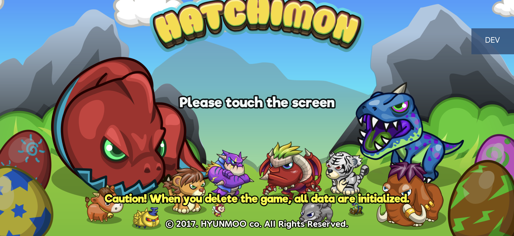
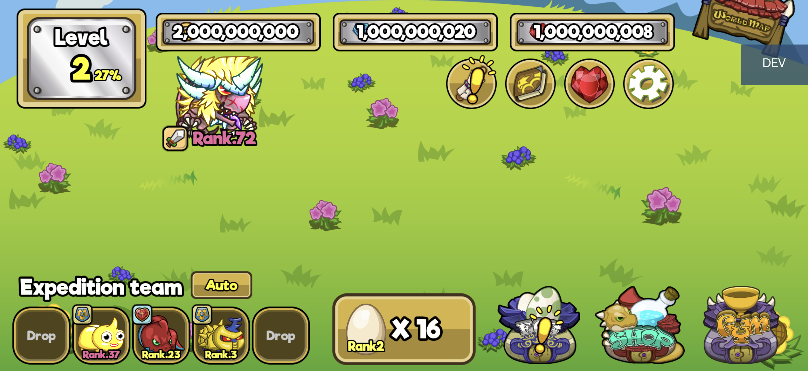
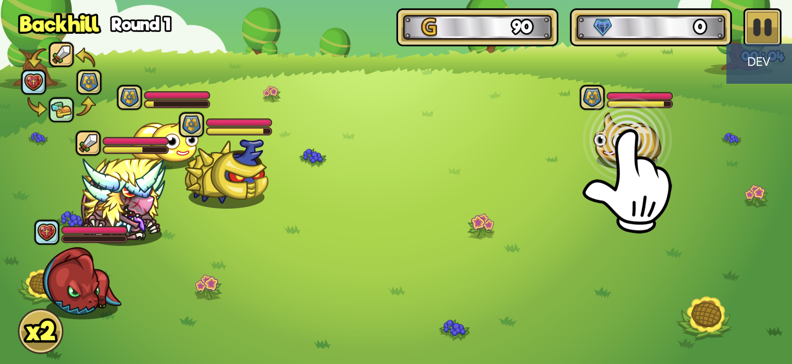

# Hatchimon Revival

**An enthusiast preservation project for Merge Hatchimon — a small Android game worth remembering and playing again.**

[Download APK](https://github.com/xxxYOUNGxxx-dev1/hatchimon-revival/releases/latest) · [Русское описание](README.ru.md) · [Build guide](docs/BUILDING.md) · [Device test report](docs/TESTING.md)




## What is Merge Hatchimon?

Merge Hatchimon is a 2017-era Android game by **Hyunmoo** about hatching creatures, merging them into stronger forms, building an expedition team, and exploring an island through battles. A little ranch, colourful monsters, evolution chains, and the satisfaction of discovering the next form are the heart of the game.

Its original build belongs to the ARM32 generation of Android games. Many modern phones now support only ARM64, leaving games like this one unable to launch even when their gameplay is still enjoyable.

For us, this is a nostalgic favourite — one of those small games that can feel legendary to the people who remember it. **Hatchimon Revival exists to introduce it to new players, preserve the knowledge needed to run it, and give people a way to try it on a modern phone.** This is a fan project, not an official release by Hyunmoo.

## What this project does

- Packages the original ARM32 engine inside an **ARM64 host using ZettaBridge translation**. It is not a native ARM64 recompilation of the game.
- Adds an Android **DEV overlay** connected to the game's own native functions.
- Fixes startup crashes caused by old advertising SDK calls on modern Android.
- Provides source code, local build scripts, reverse-engineering notes, and a documented device test record.

The original game's native engine and 358 game assets were preserved byte for byte in the tested build. The added menu, bridge, compatibility patches, and launcher are the work documented here.

## Try the game

1. Open [Releases](https://github.com/xxxYOUNGxxx-dev1/hatchimon-revival/releases/latest) and download **Merge-Hatchimon-Dev5-ARM64.apk**.
2. Install it on an **ARM64 Android 8.0+** device. Android may ask you to allow installation from the app used to open the APK.
3. Open **Merge Hatchimon Dev ARM64** and tap **Запустить игру** (Start game).
4. Give the first launch time to extract the bundled game and translation runtime.
5. Play through the introduction, open the farm, and tap **DEV** to use the developer menu.

The current packaged launcher and DEV menu use Russian labels; gameplay in the tested version uses English. This repository and its technical documentation use English, with a separate Russian overview.

The wrapper installs as `com.hyunmoo.hatchimon.arm64.dev` and keeps its own saves. Updating an APK signed with the same key preserves that installation's data. Removing the app removes those saves.

## Developer mode

| Feature | Available controls | Behaviour |
|---|---|---|
| Currency grants | Gold, Cash/crystals, rubies | Add **1–1,000,000,000** per command |
| Balance protection | Automatic | Clamp to the game's **2,000,000,000** balance ceiling without signed overflow |
| Creature spawning | Direct level input | Spawn any defined level **1–72** |
| Glowing creatures | Levels **37–72** | Use the game's original extended-tier sprites and glow effects |
| Creature type | Random or types 1–4 | Pass the selected type to the original spawn routine |
| Batch count | **1–10** | Grant multiple creatures in one command |
| Farm capacity | Automatic | Cap the total at **120**, including pending eggs; partial batches use available space |
| Persistence | Automatic | Use the game's save functions and refresh its UI caches |
| Scene guard | Farm only | Refuse game operations when the live farm scene is unavailable |

All game operations run on the Cocos2d GL thread. The menu does not manufacture purchase receipts or claim server-side rewards.

**Why the limit is 72:** this build defines 24 tiers with three forms each. Levels 37–72 reuse the 12 original sprite tiers with glow. Level 73 would request an absent sprite, and the original merge checks stop at level 72. See [architecture notes](docs/ARCHITECTURE.md).



## What was fixed

| Problem | Fix |
|---|---|
| Unity Ads terminated the process after a denied `TelephonyManager.getNetworkType()` call | Catch `SecurityException` and return an unknown network type; cover equivalent Unity/Google Ads calls |
| Vungle's internal receiver failed registration on recent Android | Use `RECEIVER_NOT_EXPORTED` for its local `DUMP_TABLES` action on API 33+ |
| Rebuilding could duplicate the launcher Activity | Deduplicate manifest Activities and retain a separate diagnostics Activity |
| The runtime lacked two legacy `DT_NEEDED` library names | Add narrowly scoped guest adapters for OpenSL ES and GLES1; the active game paths remain Java audio and GLES2 |

The OpenSL adapter only satisfies linkage and reports unsupported engine creation; it is **not an OpenSL audio implementation**. The game's active `AndroidJavaEngine` path was retained. Details are in [compatibility notes](docs/COMPATIBILITY.md).

## Validation

The tested Dev5 build ran on an **ARM64-only Android 16 phone**. We checked launch to the farm, touch interaction, normal hatching/evolution, billion-unit grants in all three currencies, the balance ceiling, spawning levels 37 and 72, battle rendering with those creatures, return to the farm, and persistence after a full process restart and APK update.

- **455 compiled ARM bridge cases** using Unicorn and mocked game exports.
- **288 original-code combinations** for creature IDs, merge targets, and sprite selection during creation/reload.
- APK signature/alignment checks, ZIP integrity, actual ELF ABI checks, and original engine/asset preservation.
- Guest dependency/export coverage and on-device crash log inspection.

These are distinct kinds of evidence. Unit emulation does not replace phone testing, and one tested phone does not establish compatibility with every device. See [the test matrix and limitations](docs/TESTING.md).



## Repository layout

```text
src/android/       DEV overlay and bundled-game launcher
src/native/        JNI bridge and narrowly scoped link adapters
stubs/             Compile-only Java declarations; never shipped
scripts/           Build, patch, install, and publication checks
tests/             ARM emulation and APK integrity checks
docs/              Build guide, architecture, compatibility, test report
evidence/          Sanitized results and release checksums
licenses/          Third-party licensing notices
.github/           CI and issue templates
```

[Building from source](docs/BUILDING.md) requires a legally obtained compatible APK, the specified ZettaBridge runtime, Java, Zig, Apktool, D8/R8, and an APK signer. Local inputs, keystores, saves, and full phone bugreports are ignored by Git.

## Project history

The work progressed from an ARM32 developer menu to an ARM64 translation wrapper, then to real-device debugging on Android 16. The final documented build is **Dev5**. [CHANGELOG.md](CHANGELOG.md) records the changes; [RESEARCH.md](docs/RESEARCH.md) lists tools and sources that informed the workflow.

## Contributing

Device compatibility reports, reproducible crash reports, improvements to the build tooling, and language support are welcome. Read [CONTRIBUTING.md](CONTRIBUTING.md) before filing an issue or sending a patch. Keep private logs and signing material out of public reports.

## Credits and licensing

The original game is by **Hyunmoo**. ARM translation is provided by [ZettaBridge](https://github.com/ZailoxTT/ZettaBridge), with upstream components retaining their own licenses. APK tooling builds on [Apktool](https://github.com/iBotPeaches/Apktool), [R8/D8](https://r8.googlesource.com/r8/), [Zig](https://ziglang.org/), [Uber APK Signer](https://github.com/patrickfav/uber-apk-signer), [Capstone](https://github.com/capstone-engine/capstone), [pyelftools](https://github.com/eliben/pyelftools), and [Unicorn](https://github.com/unicorn-engine/unicorn).

The [MIT license](LICENSE) covers project-authored tooling and documentation only. It does not relicense the original game, its assets, ZettaBridge, or the bundled APK as a whole. ZettaBridge's noncommercial/perimeter conditions remain applicable. See [THIRD_PARTY_NOTICES.md](THIRD_PARTY_NOTICES.md).
