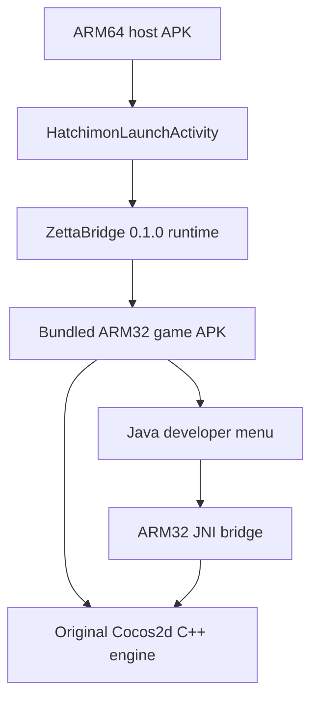

# Architecture

The host's installation ABI is `arm64-v8a`. The unchanged game engine is an ARM32 ELF and runs through ZettaBridge's translator. Packaging it under an ARM64 directory would not convert its instructions; this project does not claim a native C++ port.

`src/native/bridge.c` resolves game functions and invokes them on the Cocos GL thread. Scene checks prevent farm mutations outside the farm. Currency grants clamp both input and resulting signed 32-bit balances. Monster ranks map to the engine's existing tier/form representation; levels above 36 use its existing glow and sprite reuse behavior.

The game has 24 tiers, each with three forms. Supported ranks are 1–72, not an unbounded integer range. Adding ranks beyond 72 requires new data, assets, and evolution behavior.

`src/android/` contains the menu and host launcher. `stubs/` are compilation declarations only, excluded from packaged application classes. `dl-stub.c` is a link-time helper only.

The guest OpenSL shim exports required interface identifiers and reports unsupported engine creation. It is not an audio implementation. The observed game audio path uses Android Java audio. The empty GLES1 library satisfies a legacy dependency name; the game's imported GL functions resolve through GLES2. These shims are specific to this game's observed imports, not general compatibility libraries.

The host and guest use separate development package names. Host upgrades retain its private plugin data; save preservation was checked on the test phone. Existing installations of the original game do not automatically share saves with this wrapper.
